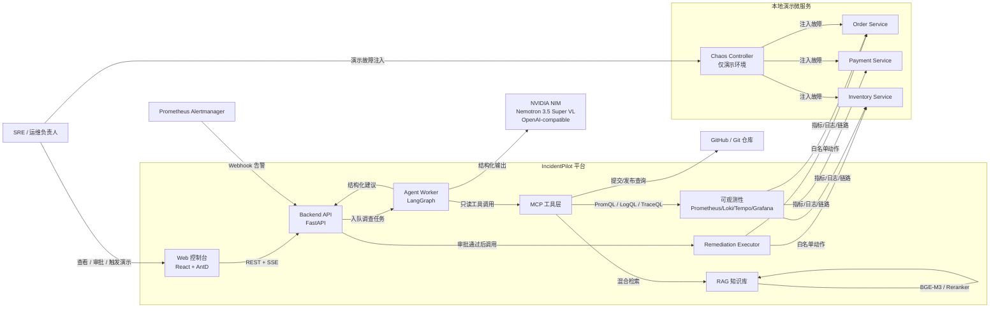
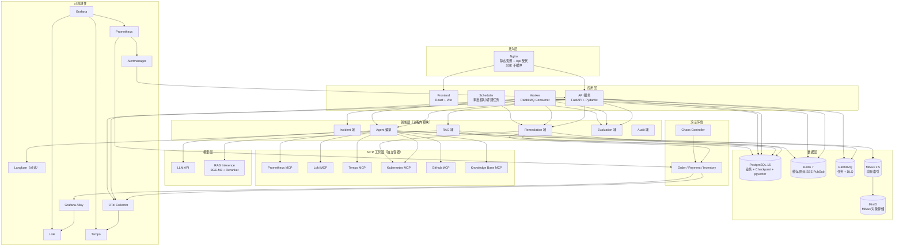
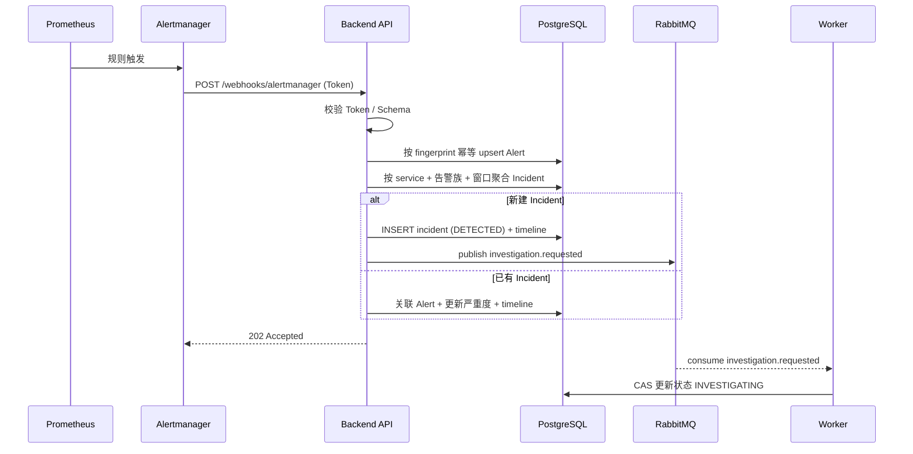
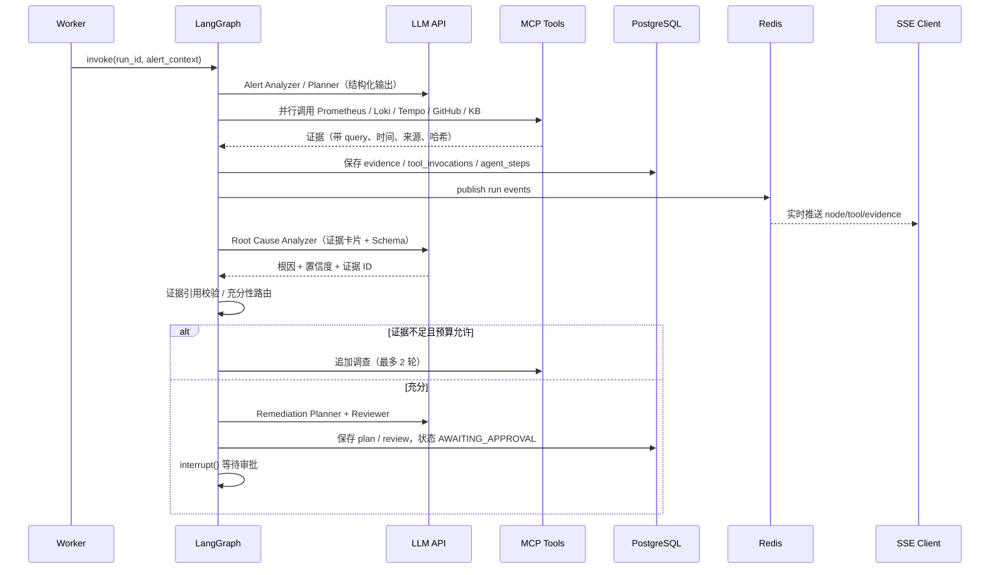
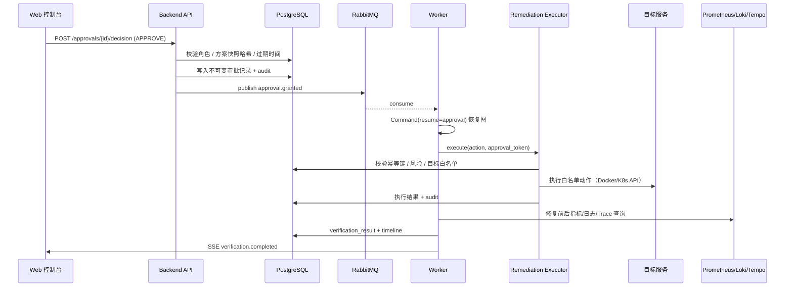

# 系统架构设计（Phase 0）

版本：v0.1（待确认）

---

## 1. 已验证的环境基线

| 项 | 实测值 | 对架构的影响 |
| --- | --- | --- |
| OS | Windows（win32） | 所有服务运行于 Linux 容器；脚本同时提供 PowerShell |
| CPU / RAM | Ryzen 7 6800H / 16 GB | 需要 Compose profiles 与内存预算，避免默认拉起全部重型组件 |
| GPU | RTX 3060 Laptop 4 GB，PyTorch 为 CPU 版 | 默认 CPU 推理；4 GB 显存不足以同时驻留 BGE-M3 与 Reranker |
| Python | 本地 3.11.9 | 项目统一 3.12，通过 Docker 或 `uv python install 3.12` |
| Node | 24.11.1 | 前端使用 Node 22+ 即可 |
| Docker | 29.6.2 + Compose v5.3.1，**daemon 当前未启动** | Phase 1 前需启动 Docker Desktop |
| 磁盘 | D: 72 GB 可用 | 镜像 + 模型 + 数据可容纳；模型只读挂载，不复制 |
| 本地模型 | `D:\mode\bge-m3-safetensors`（1024 维，CPU 加载 2.3s）；`D:\mode\bge-reranker-v2-m3`（打分 0.982/0.029 验证通过） | RAG 使用本地模型，不依赖外部 Embedding API |
| LLM API | NVIDIA NIM `https://integrate.api.nvidia.com/v1`，模型 `nvidia/nemotron-3.5-super-vl-120b-a12b`；已验证 Chat、`json_object`、Function Calling | 主模型确定；推理模型需预留 `reasoning_tokens` |
| 端口 | 5432/6379/5672/8000/5173/9090/3100/3200/19530/3000 均未占用 | 默认端口可直接使用 |

---

## 2. 架构原则

1. **AI 提议，程序执行**：模型只能产出结构化建议；权限、校验、执行、验证由确定性代码完成。
2. **证据优先**：任何根因结论必须引用工具返回的证据 ID；无证据则输出 `UNKNOWN` 或低置信度。
3. **持久化优先**：任务状态、审批、执行、审计全部落 PostgreSQL；Redis 只做缓存/广播，不作为事实源。
4. **显式边界**：API → Application Service → Domain → Repository / Adapter，禁止路由函数承载业务逻辑。
5. **可恢复**：LangGraph Checkpoint + 消息队列 + 幂等键，保证 worker 崩溃后可续跑。
6. **默认可观测**：请求 ID、Incident ID、Run ID 贯穿日志、Trace、指标、Langfuse。
7. **默认安全**：只读工具、白名单动作、参数 Schema、审批门禁、全量审计。
8. **演示与生产隔离**：故障注入仅存在于 `demo-control`，独立网络与 Token，Agent 不可见。
9. **不造数据**：监控数据由真实服务产生；评测结果来自真实执行并记录版本。
10. **优先成熟组件**：不引入无法在 16 GB 机器上稳定运行的依赖。

---

## 3. 系统上下文图



---

## 4. 容器/组件图



---

## 5. 关键流程时序

### 5.1 告警接入与事件归一化



### 5.2 Agent 多源调查



### 5.3 审批、执行与验证



---

## 6. 技术选型与理由

| 领域 | 选型 | 理由 | 备选与取舍 |
| --- | --- | --- | --- |
| Web 框架 | FastAPI + Pydantic v2 | 原生 async、OpenAPI、类型校验强，适合工具 Schema 与 API 契约 | Flask/Django 同步模型不利于 SSE 与高并发 I/O |
| ORM | SQLAlchemy 2.x async + asyncpg | 成熟、支持异步、迁移生态完整 | Tortoise ORM 生态较小 |
| 迁移 | Alembic | 与 SQLAlchemy 一致，可审查 SQL | 手写 DDL 不可接受 |
| 主库 | PostgreSQL 16 | JSONB、部分索引、全文能力、pgvector 备选、LangGraph Checkpoint 支持 | MySQL JSON/索引能力较弱 |
| 缓存/广播 | Redis 7 | 限流、缓存、SSE Pub/Sub、分布式锁 | 不作为事实源 |
| 消息队列 | RabbitMQ 4.x | 持久化、ACK、DLQ、路由灵活，适合调查任务 | Kafka 过重；Redis Stream 可靠性弱于 Rabbit |
| Agent 编排 | LangGraph | 显式状态图、并行分支、Checkpoint、`interrupt()` HITL | 自研状态机成本高；多 Agent 聊天不可控 |
| 模型接入 | LangChain + OpenAI-compatible（NVIDIA NIM） | 已验证 Chat / JSON 模式 / Function Calling；切换 Qwen/DeepSeek 只需改配置 | 直接 SDK 会重复实现工具/结构化输出 |
| 结构化输出 | Pydantic Schema + 校验重试 | 根因/计划必须可校验、可引用 | 自由文本无法做证据校验 |
| MCP | 官方 Python SDK（FastMCP） + `langchain-mcp-adapters` | 标准协议、独立部署、工具可复用 | 直接 HTTP 工具会失去 MCP 生态价值 |
| 向量库 | Milvus 2.5 standalone | 企业常用、支持标量过滤与大规模索引 | 内存占用高；提供 pgvector 适配器兜底 |
| Embedding | 本地 BGE-M3（1024 维） | 已实测可用、无 API 成本、中文效果好 | 本地 CPU 推理有延迟，故独立推理服务 |
| 重排 | 本地 BGE Reranker v2-m3 | 已实测打分合理，显著提升 Top-K 精度 | 可选更小模型降延迟 |
| 稀疏检索 | bm25s + jieba | 轻量、可持久化、中文分词可控 | Elasticsearch 过重 |
| 文档解析 | PyMuPDF（默认）+ MinerU（可选） | PDF 稳定；复杂版面用 MinerU 增强 | MinerU 依赖重，放 optional profile |
| 前端 | React 19 + TypeScript + Vite + AntD 5 | 企业后台组件成熟、开发效率高 | 自研组件成本高 |
| 图表 | ECharts 5 | 指标曲线、调用链甘特图能力强 | AntD Charts 封装受限 |
| 数据请求 | TanStack Query 5 | 缓存、重试、失效、加载态标准化 | 手写 useEffect 易失控 |
| 状态 | Zustand | 轻量，仅存 UI/会话状态 | Redux 过重 |
| 可观测 | Prometheus + Grafana + Loki + Tempo + OTel | 指标/日志/链路三件套，行业标准 | 商业 APM 成本高 |
| 日志采集 | Grafana Alloy | Promtail 已进入维护尾声，Alloy 为官方方向 | Fluent Bit 亦可 |
| LLM 观测 | Langfuse（云端优先，自托管可选） | 查看 Prompt/Token/成本/工具调用 | 自托管 ClickHouse 资源占用高 |
| 测试 | Pytest + HTTPX + Playwright + 自建评测 | 覆盖单元/集成/E2E/Agent 评测 | 仅单测无法验证闭环 |
| 依赖管理 | uv + lockfile | 安装快、可复现、可管理 Python 3.12 | pip 无锁、Poetry 较慢 |
| 代码质量 | ruff + mypy + pre-commit | 快速 lint/format/类型检查 | 仅 ruff 缺少类型保障 |

### 6.1 LLM 接入实测（NVIDIA NIM）

| 能力 | 实测结果 |
| --- | --- |
| Chat Completions | 可用；响应 `model=private/nvidia/nemotron-3.5-super-120b-a12b` |
| 简单 JSON 指令 | 1.08s，输出精确 JSON |
| `response_format={"type":"json_object"}` | 可用；`max_tokens=300` 时因 301 个 `reasoning_tokens` 导致 `content` 为空，提高到 1200 后正常 |
| Function Calling | 可用，返回合法 `tool_calls` 参数（服务、指标、时间窗、step 均正确） |
| 推理内容 | 返回 `reasoning_content`；**剥离，不落库、不展示**，仅统计 `reasoning_tokens` |
| 结论 | 主模型可用；结构化输出使用 `json_mode` + Pydantic 校验，不依赖未验证的 `json_schema` |

配置基线：`LLM_MAX_TOKENS=4096`、超时 180s、并发 4、429 指数退避、最多 2 次重试。

---

## 7. 模块划分与依赖规则

```
API Layer（路由、鉴权、DTO）
   ↓ 只调用
Application Service（用例编排、事务边界、权限策略）
   ↓ 调用
Domain（状态机、证据规则、风险策略、验证判定）
   ↓ 通过端口
Repository / Adapter（PostgreSQL、Redis、MQ、MCP、Docker/K8s、LLM、Milvus）
```

规则：

1. `api/` 不得直接使用 SQLAlchemy Session 或 MCP Client；
2. `domain/` 不依赖 FastAPI、SQLAlchemy、网络库；
3. `repositories/` 只做持久化，不含业务分支；
4. `agents/` 只做编排与工具调用，不直接写库（通过回调/服务）；
5. 所有跨进程调用必须有超时、重试上限、结构化错误；
6. 写操作必须经过 `AuditService`。

### 后端模块

| 模块 | 职责 |
| --- | --- |
| `api/` | REST/SSE/Webhook 路由、认证、参数校验、响应序列化 |
| `core/` | 配置、日志、异常、安全、限流、Telemetry |
| `models/` | SQLAlchemy ORM |
| `schemas/` | Pydantic DTO / Agent 结构化输出 |
| `repositories/` | 数据访问 |
| `services/` | Alert/Incident/Agent/Remediation/Verification/Knowledge/Evaluation/Audit 用例 |
| `agents/` | LangGraph 图、节点、Prompt、工具治理、Checkpoint |
| `mcp_client/` | MCP 连接、工具发现、调用治理 |
| `rag/` | 解析、Chunk、Embedding、BM25、Milvus、RRF、Rerank、引用 |
| `remediation/` | 动作目录、风险策略、执行器、Docker/K8s 后端、幂等 |
| `evaluation/` | 数据集、运行器、指标计算 |
| `workers/` | RabbitMQ 消费者、任务、定时任务 |
| `observability/` | OTel、Langfuse、指标定义 |

### MCP Server（独立部署）

`mcp_servers/` 下每个 Server 独立镜像/进程，仅通过 MCP 协议暴露工具，不共享后端数据库连接（Knowledge Base 通过内部 API 访问）。

### 演示微服务（独立部署）

`demo-services/` 三个 FastAPI 服务 + `chaos-controller`，仅加入 demo 网络，不对公网暴露。

---

## 8. Monorepo 目录结构

```
IncidentPilot/
├── backend/
│   ├── app/
│   │   ├── main.py
│   │   ├── api/v1/
│   │   ├── core/
│   │   ├── db/
│   │   ├── models/
│   │   ├── schemas/
│   │   ├── repositories/
│   │   ├── services/
│   │   ├── domain/
│   │   ├── agents/{graphs,nodes,state,prompts,tools}/
│   │   ├── mcp_client/
│   │   ├── rag/
│   │   ├── remediation/{actions,backends,policies}/
│   │   ├── evaluation/
│   │   ├── observability/
│   │   └── workers/
│   ├── alembic/
│   ├── tests/{unit,integration,contract,e2e,eval}/
│   └── pyproject.toml
├── frontend/
│   └── src/{api,components,pages,hooks,types,layouts,stores,styles}/
├── mcp_servers/
│   ├── common/
│   ├── prometheus/
│   ├── loki/
│   ├── tempo/
│   ├── kubernetes/
│   ├── github/
│   └── knowledge_base/
├── rag_inference/            # 本地 BGE-M3 + Reranker HTTP 服务
├── demo-services/
│   ├── order-service/
│   ├── payment-service/
│   ├── inventory-service/
│   └── chaos-controller/
├── infrastructure/
│   ├── docker/
│   ├── prometheus/
│   ├── alertmanager/
│   ├── grafana/
│   ├── loki/
│   ├── tempo/
│   ├── otel/
│   ├── nginx/
│   └── milvus/
├── evaluation/
│   └── datasets/
├── scripts/
├── docs/
├── docker-compose.yml
├── docker-compose.override.yml
├── .env.example
├── .gitignore
└── README.md
```

---

## 9. 部署拓扑与网络

| 网络 | 成员 | 说明 |
| --- | --- | --- |
| `edge` | nginx、frontend | 仅 nginx 发布端口 |
| `app` | backend、worker、scheduler、mcp servers | 应用内部通信 |
| `data` | postgres、redis、rabbitmq、milvus、minio、etcd | 仅应用网络可访问 |
| `obs` | prometheus、alertmanager、loki、tempo、otel、alloy、grafana、demo services | 抓取与推送 |
| `demo` | demo services、chaos-controller | 与生产执行隔离；chaos 不暴露公网 |

端口发布策略：

- 对外仅 `80/8080`（nginx）与开发期 `5173`（Vite）；
- Grafana/Prometheus/Alertmanager 可选本地映射，默认仅内网；
- MCP Server 不发布端口，仅 `app` 网络；
- PostgreSQL/Redis/RabbitMQ/Milvus 不发布端口（调试时通过 profile 临时映射）。

---

## 10. 非功能设计

### 10.1 幂等

| 场景 | 幂等键 |
| --- | --- |
| 告警入库 | `sha256(source + alertname + service + severity + labels)` + `startsAt` |
| Incident 聚合 | `service + alert_family + 15min window` |
| 调查任务 | `incident_id + investigation_round` |
| 修复动作 | `incident_id + plan_version + action_type + target + params_hash` |
| 审批 | `plan_id + plan_version + action_id` 唯一 |
| SSE 事件 | `run_id + sequence` 唯一 |

### 10.2 一致性与事务

- Incident 创建 + Alert 关联 + Outbox 消息在同一数据库事务内提交；
- Outbox 表由调度器轮询投递 RabbitMQ（至少一次），消费者幂等；
- 审批记录只追加，不更新决策；
- 执行结果与审计同事务写入。

### 10.3 失败处理

| 故障 | 策略 |
| --- | --- |
| MCP 超时 | 单工具超时 8s；重试 1 次（指数退避）；熔断 30s |
| LLM 超时/限流 | 超时 60s；重试 2 次；降级到备用模型或终止 |
| LLM 结构化输出非法 | 修复重试 1 次；仍失败则记录 raw 并终止该节点 |
| Worker 崩溃 | RabbitMQ 未 ACK 重投；Checkpoint 恢复；幂等键防重复副作用 |
| 审批超时 | 15 分钟过期，恢复图并标记 REJECTED/TIMEOUT |
| 执行失败 | 最多 1 次重试；之后 FAILED，保留现场与回滚信息 |
| 验证数据不足 | `INSUFFICIENT_DATA`，不得标记成功 |
| 告警风暴 | 去重 + 聚合 + 每服务每分钟入队上限 + 背压 |

### 10.4 时间与数据窗口

- 全系统 UTC 存储，前端按浏览器时区展示；
- 调查窗口默认 `[alert_start - 30m, now]`；
- 验证基线 `[alert_start - 30m, alert_start]`，观察窗 `[execution_end, execution_end + 10m]`；
- 所有查询显式传 `start/end`，禁止依赖 Prometheus 默认时间。

### 10.5 保留与归档

| 数据 | 保留 |
| --- | --- |
| Incident / Evidence / Audit | 永久（演示库可手动清理） |
| Agent Step / Tool Invocation | 180 天 |
| SSE 事件 | 30 天（之后仅保留步骤快照） |
| 日志 | Loki 7 天 |
| Trace | Tempo 7 天 |
| 指标 | Prometheus 15 天 |

---

## 11. 关键架构决策（ADR 摘要）

| ADR | 决策 | 原因 |
| --- | --- | --- |
| ADR-001 | 模块化单体 + 独立 MCP/演示服务 | 降低分布式复杂度，保留清晰边界，符合实习项目规模 |
| ADR-002 | Agent 与 Executor 分离 | 模型不可信；执行必须可审计、可审批、可幂等 |
| ADR-003 | 调查任务异步化（RabbitMQ） | 调查耗时长，API 只负责创建与查询 |
| ADR-004 | LangGraph Checkpoint 存 PostgreSQL | 与主库一致，支持跨 worker 恢复与 HITL |
| ADR-005 | 本地 BGE-M3 + Reranker 独立推理服务 | 已验证可用；隔离内存与延迟，避免后端容器膨胀 |
| ADR-006 | Milvus 默认 + pgvector 适配器兜底 | 满足企业技术栈要求，同时照顾 16 GB 开发机 |
| ADR-007 | 结构化工具参数，不暴露任意 PromQL/LogQL | 防注入、可评测、可审计 |
| ADR-008 | SSE 事件落库 + Redis 广播 | 断线可回放，避免纯内存推送丢事件 |
| ADR-009 | Docker 执行后端默认，K8s 可选 | Compose 演示环境可复现；k3d 提供真实 K8s 能力 |
| ADR-010 | 审批使用 LangGraph `interrupt()` | 原生 HITL，状态持久化，跨进程恢复 |
| ADR-011 | 主 LLM 使用 NVIDIA NIM（Nemotron 3.5 Super VL） | 已验证 Chat/JSON/Function Calling；OpenAI-compatible，可通过配置切换 |
| ADR-012 | 推理内容不落库 | `reasoning_content` 体积大且含中间思考；只保留 Token 统计与最终结构化输出 |

---

## 12. 待确认的架构决策

见 [09-roadmap-risks.md](09-roadmap-risks.md) 第 3 节。默认推荐：

1. Milvus 默认启用，pgvector 作为低内存备选；
2. RAG 推理服务在宿主机运行（16 GB 内存最优），同时提供容器 profile；
3. Langfuse 先用云端免费额度，OTel 本地链路完整；自托管为可选 profile；
4. 修复后端默认 Docker（Compose），K8s 通过 k3d 可选；
5. 主模型 NVIDIA NIM（`nvidia/nemotron-3.5-super-vl-120b-a12b`），Qwen/DeepSeek 作为可选切换；
6. 项目 Python 3.12 使用 Docker/uv，不修改本地 3.11。
