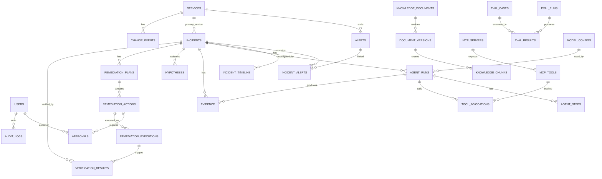
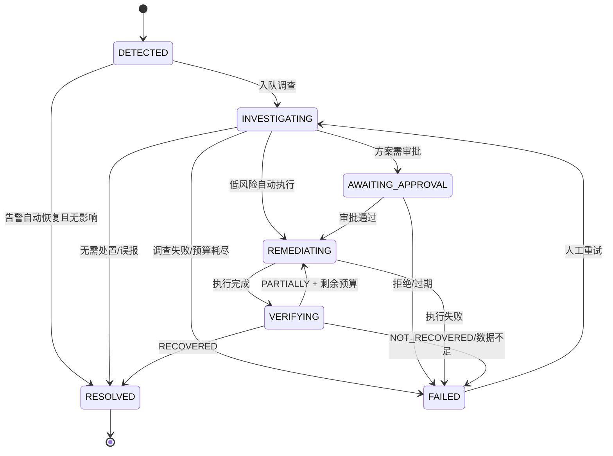

# 数据模型设计（Phase 0）

版本：v0.1（待确认）
数据库：PostgreSQL 16
约定：主键使用 UUIDv7（时间有序）；时间统一 `timestamptz` UTC；金额/成本用 `numeric`；枚举使用 `varchar + CHECK`（便于迁移，不用 PostgreSQL ENUM）。

---

## 1. ER 图



---

## 2. 核心表

### 2.1 身份与权限

| 表 | 关键列 | 约束/索引 |
| --- | --- | --- |
| `users` | `id`, `email`, `hashed_password`, `full_name`, `role` (`VIEWER/SRE/ADMIN`), `is_active`, `last_login_at`, `created_at` | `UNIQUE(email)`; `INDEX(role, is_active)` |
| `refresh_tokens` | `id`, `user_id`, `token_hash`, `jti`, `expires_at`, `revoked_at`, `user_agent`, `ip` | `UNIQUE(jti)`; `INDEX(user_id, expires_at)`; 只存哈希 |
| `audit_logs` | `id`, `actor_type` (`USER/SYSTEM/AGENT`), `actor_id`, `action`, `resource_type`, `resource_id`, `before jsonb`, `after jsonb`, `ip`, `request_id`, `created_at` | `INDEX(created_at DESC)`; `INDEX(resource_type, resource_id)`; 只追加 |

### 2.2 服务与变更

| 表 | 关键列 | 约束/索引 |
| --- | --- | --- |
| `services` | `id`, `name` (唯一), `display_name`, `namespace`, `tier` (`CORE/STANDARD/EDGE`), `repo_url`, `owner_team`, `slo jsonb` (`p95_ms`, `error_rate`), `labels jsonb`, `created_at` | `UNIQUE(name)` |
| `change_events` | `id`, `service_id`, `type` (`COMMIT/PR/RELEASE/ROLLBACK`), `ref`, `title`, `author`, `committed_at`, `files jsonb`, `diff_summary`, `source` (`GITHUB/LOCAL`), `metadata jsonb` | `INDEX(service_id, committed_at DESC)`; `UNIQUE(source, ref)` |

### 2.3 告警与事件

| 表 | 关键列 | 约束/索引 |
| --- | --- | --- |
| `alerts` | `id`, `fingerprint`, `source` (`PROMETHEUS/ALERTMANAGER`), `rule_name`, `severity` (`CRITICAL/WARNING/INFO`), `status` (`FIRING/RESOLVED/SUPPRESSED`), `service_id`, `labels jsonb`, `annotations jsonb`, `starts_at`, `ends_at`, `last_seen_at`, `occurrence_count`, `raw_payload jsonb`, `incident_id`, `created_at` | `UNIQUE(fingerprint, starts_at)`; `INDEX(status, starts_at DESC)`; `INDEX(incident_id)`; `INDEX(service_id, starts_at DESC)` |
| `incidents` | `id`, `incident_no` (`INC-20261110-0001`), `title`, `status`, `severity` (`SEV1..SEV4`), `primary_service_id`, `started_at`, `detected_at`, `resolved_at`, `summary`, `root_cause_label`, `root_cause_confidence`, `current_run_id`, `created_by`, `version int`, `created_at`, `updated_at` | `UNIQUE(incident_no)`; `INDEX(status, started_at DESC)`; `INDEX(primary_service_id, started_at DESC)`; `INDEX(severity, status)` |
| `incident_alerts` | `incident_id`, `alert_id`, `linked_at` | `PK(incident_id, alert_id)` |
| `incident_timeline` | `id`, `incident_id`, `event_type`, `actor_type`, `actor_id`, `summary`, `payload jsonb`, `created_at` | `INDEX(incident_id, created_at)` |

### 2.4 Agent 执行

| 表 | 关键列 | 约束/索引 |
| --- | --- | --- |
| `agent_runs` | `id`, `incident_id`, `thread_id`, `graph_version`, `status`, `round`, `model_config_id`, `model_name`, `started_at`, `ended_at`, `duration_ms`, `prompt_tokens`, `completion_tokens`, `reasoning_tokens`, `cost_usd numeric NULL`, `error_code`, `error_message`, `state_snapshot jsonb` | `UNIQUE(thread_id)`; `INDEX(incident_id, started_at DESC)`; `INDEX(status)` |
| `agent_steps` | `id`, `run_id`, `sequence`, `node_name`, `status` (`RUNNING/SUCCEEDED/FAILED/SKIPPED`), `attempt`, `input_summary jsonb`, `output_summary jsonb`, `started_at`, `ended_at`, `duration_ms`, `error_message` | `UNIQUE(run_id, sequence)`; `INDEX(run_id, started_at)` |
| `tool_invocations` | `id`, `run_id`, `step_id`, `server_name`, `tool_name`, `permission_level`, `arguments jsonb`, `result_summary jsonb`, `result_hash`, `status` (`OK/ERROR/TIMEOUT/DENIED`), `latency_ms`, `error_code`, `error_message`, `created_at` | `INDEX(run_id, created_at)`; `INDEX(tool_name, created_at DESC)`; `INDEX(status)` |
| `evidence` | `id`, `incident_id`, `run_id`, `source_type` (`METRIC/LOG/TRACE/CHANGE/KNOWLEDGE/HEALTH/ALERT`), `source_ref`, `tool_invocation_id`, `service_id`, `trace_id`, `query jsonb`, `observed_at`, `window_start`, `window_end`, `title`, `content text`, `content_hash`, `reliability numeric`, `metadata jsonb` | `UNIQUE(incident_id, content_hash)`; `INDEX(incident_id, source_type)`; `INDEX(run_id)`; `INDEX(trace_id)` |
| `hypotheses` | `id`, `incident_id`, `run_id`, `label`, `statement`, `confidence numeric`, `status` (`SUPPORTED/REJECTED/UNKNOWN`), `evidence_ids uuid[]`, `rationale`, `created_at` | `INDEX(incident_id)`; `CHECK(confidence BETWEEN 0 AND 1)` |

### 2.5 修复、审批与验证

| 表 | 关键列 | 约束/索引 |
| --- | --- | --- |
| `remediation_plans` | `id`, `incident_id`, `run_id`, `version`, `status` (`DRAFT/PENDING_APPROVAL/APPROVED/REJECTED/EXECUTING/COMPLETED/FAILED`), `risk_level` (`LOW/MEDIUM/HIGH`), `summary`, `rationale`, `expected_effect`, `verification_plan jsonb`, `evidence_ids uuid[]`, `plan_hash`, `created_at` | `UNIQUE(incident_id, version)`; `INDEX(status)`; `INDEX(plan_hash)` |
| `remediation_actions` | `id`, `plan_id`, `sequence`, `action_type`, `target_type` (`SERVICE/CACHE/DEPLOYMENT`), `target_id`, `parameters jsonb`, `risk_level`, `requires_approval bool`, `preconditions jsonb`, `expected_effect`, `idempotency_key`, `status`, `attempt`, `max_attempts`, `created_at` | `UNIQUE(idempotency_key)`; `INDEX(plan_id, sequence)`; `INDEX(status)` |
| `approvals` | `id`, `action_id`, `plan_id`, `plan_hash`, `requested_by`, `requested_at`, `approver_id`, `decision` (`PENDING/APPROVED/REJECTED/EXPIRED`), `comment`, `decided_at`, `expires_at`, `context_snapshot jsonb` | `UNIQUE(action_id, plan_hash)`; `INDEX(decision, expires_at)`; `INDEX(approver_id, decided_at DESC)` |
| `remediation_executions` | `id`, `action_id`, `executor` (`DOCKER/K8S`), `status` (`RUNNING/SUCCEEDED/FAILED/TIMEOUT/ROLLED_BACK`), `attempt`, `started_at`, `ended_at`, `output jsonb`, `error_code`, `error_message`, `rollback_info jsonb` | `INDEX(action_id, started_at DESC)`; `INDEX(status)` |
| `verification_results` | `id`, `incident_id`, `execution_id`, `verdict` (`RECOVERED/PARTIALLY_RECOVERED/NOT_RECOVERED/INSUFFICIENT_DATA`), `checks jsonb`, `metrics_before jsonb`, `metrics_after jsonb`, `window_start`, `window_end`, `data_points int`, `notes`, `created_at` | `INDEX(incident_id, created_at DESC)`; `INDEX(verdict)` |

### 2.6 知识库

| 表 | 关键列 | 约束/索引 |
| --- | --- | --- |
| `knowledge_documents` | `id`, `title`, `source_type` (`PDF/MARKDOWN/TXT/INCIDENT/SOP`), `service_scope`, `current_version`, `status` (`ACTIVE/ARCHIVED`), `checksum`, `metadata jsonb`, `created_by`, `created_at`, `updated_at` | `INDEX(service_scope, status)`; `INDEX(checksum)` |
| `document_versions` | `id`, `document_id`, `version`, `storage_path`, `parsed_at`, `chunk_count`, `embedding_model`, `embedding_dim`, `index_generation`, `status` (`PARSING/INDEXING/READY/FAILED`), `error_message` | `UNIQUE(document_id, version)`; `INDEX(index_generation)`; `INDEX(status)` |
| `knowledge_chunks` | `id`, `version_id`, `document_id`, `chunk_index`, `content`, `token_count`, `section_path`, `page_no`, `metadata jsonb`, `vector_id`, `content_hash` | `UNIQUE(version_id, chunk_index)`; `INDEX(document_id)`; `INDEX(vector_id)`; GIN(`metadata`) |
| `retrieval_logs` | `id`, `query`, `filters jsonb`, `bm25_hits jsonb`, `vector_hits jsonb`, `rrf_hits jsonb`, `rerank_hits jsonb`, `latency_ms`, `run_id`, `created_at` | `INDEX(created_at DESC)`; `INDEX(run_id)` |

### 2.7 工具、模型与评测

| 表 | 关键列 | 约束/索引 |
| --- | --- | --- |
| `mcp_servers` | `id`, `name` (唯一), `endpoint`, `transport` (`STREAMABLE_HTTP/STDIO`), `status`, `last_health_at`, `metadata jsonb` | `UNIQUE(name)` |
| `mcp_tools` | `id`, `server_id`, `name`, `description`, `input_schema jsonb`, `output_schema jsonb`, `permission_level` (`READ/WRITE_LOW/WRITE_HIGH`), `timeout_ms`, `enabled`, `discovered_at` | `UNIQUE(server_id, name)`; `INDEX(permission_level, enabled)` |
| `model_configs` | `id`, `name`, `provider`, `base_url`, `model_name`, `temperature`, `max_tokens`, `timeout_s`, `max_concurrency`, `price_input_per_1k numeric NULL`, `price_output_per_1k numeric NULL`, `is_default`, `api_key_ciphertext`, `created_at` | `UNIQUE(name)`; 只允许一个 `is_default`（部分唯一索引） |
| `eval_cases` | `id`, `name`, `scenario`, `fault_type`, `service`, `expected_root_cause`, `acceptable_root_causes text[]`, `required_evidence text[]`, `expected_tools text[]`, `expected_action`, `fixture jsonb`, `difficulty`, `active` | `INDEX(fault_type, active)`; `UNIQUE(name)` |
| `eval_runs` | `id`, `dataset_version`, `status`, `model_config`, `started_at`, `ended_at`, `metrics jsonb`, `config jsonb`, `created_by` | `INDEX(started_at DESC)` |
| `eval_results` | `id`, `run_id`, `case_id`, `incident_id`, `predicted_root_cause`, `top3 jsonb`, `evidence_accuracy numeric`, `tool_selection_accuracy numeric`, `tool_argument_accuracy numeric`, `task_completed bool`, `remediation_success bool`, `false_recovery bool`, `latency_ms`, `tokens int`, `raw jsonb` | `UNIQUE(run_id, case_id)`; `INDEX(run_id)` |

### 2.8 可靠性与实时事件

| 表 | 关键列 | 约束/索引 |
| --- | --- | --- |
| `outbox_events` | `id`, `topic`, `payload jsonb`, `status` (`PENDING/SENT/FAILED`), `attempts`, `next_attempt_at`, `created_at`, `sent_at` | `INDEX(status, next_attempt_at)`; 事务内写入 |
| `sse_events` | `id bigserial`, `run_id`, `incident_id`, `sequence`, `event_type`, `payload jsonb`, `created_at` | `UNIQUE(run_id, sequence)`; `INDEX(incident_id, id)`; 支持 `Last-Event-ID` 回放 |

---

## 3. 状态机

### 3.1 Incident



转移守卫：

| 转移 | 守卫 |
| --- | --- |
| `INVESTIGATING → AWAITING_APPROVAL` | Reviewer 通过且存在 `requires_approval` 动作 |
| `INVESTIGATING → REMEDIATING` | 仅 `LOW` 风险且 `AUTO_APPROVE_LOW_RISK=true`（仅 DEMO） |
| `AWAITING_APPROVAL → REMEDIATING` | 审批 `APPROVED` 且 `plan_hash` 一致、未过期 |
| `VERIFYING → REMEDIATING` | `PARTIALLY_RECOVERED` 且 `execution_attempts < 2` |
| 任意 → `FAILED` | 必须写 `failure_reason` 与时间线 |

### 3.2 Agent Run

`QUEUED → RUNNING → (WAITING_APPROVAL → RESUMING → RUNNING) → SUCCEEDED | FAILED | CANCELLED | TIMED_OUT`

### 3.3 Remediation Action

`PLANNED → AWAITING_APPROVAL → APPROVED → EXECUTING → SUCCEEDED | FAILED | TIMEOUT`

`PLANNED → SKIPPED`（前置条件不满足）；`AWAITING_APPROVAL → REJECTED | EXPIRED`。

### 3.4 Verification

| 判定 | 条件 |
| --- | --- |
| `RECOVERED` | 全部硬性检查通过且数据点 ≥ 最小值 |
| `PARTIALLY_RECOVERED` | 主指标改善但未达阈值，或部分检查失败 |
| `NOT_RECOVERED` | 主指标未改善或恶化 |
| `INSUFFICIENT_DATA` | 数据点不足/查询失败，禁止判成功 |

---

## 4. 告警去重与聚合算法

```text
fingerprint = sha256(
  source | alertname | service | severity |
  sorted(selected_labels: instance, job, cluster, namespace, pod)
)

1. 收到 Webhook：
   - 校验 Token、Schema、startsAt 可解析
   - 计算 fingerprint
   - UPSERT alerts ON CONFLICT (fingerprint, starts_at):
       status=firing, last_seen_at=now, occurrence_count += 1
2. 若 status=resolved：
   - 更新对应 Alert 为 RESOLVED，写 timeline
   - 若 Incident 下所有 Alert 均 resolved → 进入待验证/自动关闭流程
3. 聚合：
   - 查找同 service、同 alert_family、status 非终态、
     started_at 在 [now-15min, now] 的 Incident
   - 命中 → 关联 Alert，severity = max(现有, 新告警)
   - 未命中 → 新建 Incident：
       incident_no = INC-YYYYMMDD-序号（数据库序列）
       status=DETECTED，写入 Outbox(investigation.requested)
4. 限流：
   - 每服务每分钟最多创建 3 个 Incident
   - 超出进入 pending_aggregation，由调度器合并
```

`alert_family` 由配置映射（如 `HighErrorRate`、`HighLatency`、`InstanceDown` 归入 `availability`；`DBPoolExhausted`、`DBConnectionsHigh` 归入 `database`）。

---

## 5. 索引与查询模式

| 查询 | 索引 |
| --- | --- |
| Incident 列表按状态/时间 | `incidents(status, started_at DESC)` |
| 服务维度故障历史 | `incidents(primary_service_id, started_at DESC)` |
| 告警去重 | `alerts(fingerprint, starts_at)` 唯一 |
| 证据按 Incident/来源 | `evidence(incident_id, source_type)` |
| Agent 时间线 | `agent_steps(run_id, sequence)` |
| 工具审计 | `tool_invocations(tool_name, created_at DESC)` |
| 待审批队列 | `approvals(decision, expires_at)` |
| 审计检索 | `audit_logs(resource_type, resource_id)`、`audit_logs(created_at DESC)` |
| SSE 回放 | `sse_events(run_id, sequence)` 唯一 |
| 知识库过滤 | `knowledge_chunks(document_id)` + `GIN(metadata)` |

大字段（`raw_payload`、`output`、`state_snapshot`）使用 JSONB；超过 256 KB 的内容压缩后存储或落对象存储（Phase 4 再引入）。

---

## 6. 迁移与数据治理

1. 所有表结构变更通过 Alembic 迁移，禁止手改数据库；
2. 迁移文件需可回滚（`downgrade` 必须实现）；
3. 种子数据（演示服务、SOP 文档、评测用例）通过独立 `seed` 命令写入，不混入迁移；
4. 审计表只追加，应用层禁止 UPDATE/DELETE；
5. 敏感字段（模型 API Key）使用 Fernet 加密后存储，密钥来自环境变量；
6. 演示数据清理脚本按 `incident_no` 前缀与时间范围删除，不触碰用户与知识库；
7. 备份：演示环境提供 `pg_dump` 脚本；生产化时补充 PITR 方案（不在第一阶段范围）。
