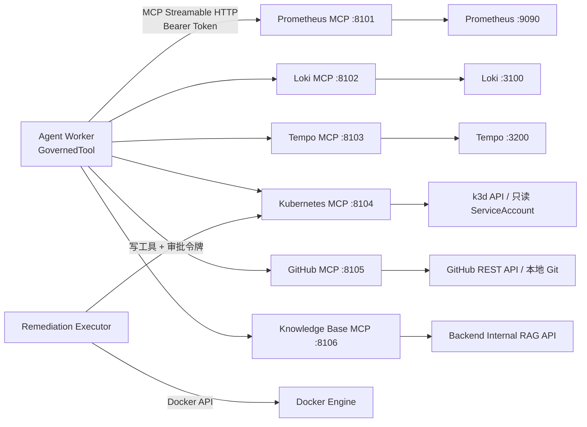

# MCP 工具设计（Phase 0）

版本：v0.1（待确认）
协议：Model Context Protocol（Python SDK / FastMCP）
传输：Streamable HTTP（生产/Compose）、stdio（本地单进程调试）

---

## 1. 设计原则

1. **工具是边界，不是 Prompt**：所有监控/日志/链路查询封装为 MCP 工具，不把查询逻辑塞进系统提示词。
2. **结构化参数**：不向模型暴露任意 PromQL / LogQL / TraceQL；由 Server 用模板 + 白名单拼接。
3. **权限内建**：每个工具声明 `permission_level`，Agent 只能看到 `READ`。
4. **可审计**：每次调用记录 server、tool、参数、耗时、结果哈希、错误。
5. **有界返回**：统一截断与摘要，防止 Token 爆炸。
6. **失败可处理**：统一错误码与 `retryable`，Agent 能降级而不是崩溃。
7. **独立部署**：每个 Server 独立容器，不共享后端数据库连接；只依赖只读上游或内部 API。

---

## 2. 拓扑与认证



认证：

- 每个 MCP Server 校验 `Authorization: Bearer ${MCP_SERVER_TOKEN}`；
- Agent 与 Executor 使用不同 Token（`AGENT_MCP_TOKEN` / `EXECUTOR_MCP_TOKEN`）；
- Knowledge Base MCP 额外携带 `X-Internal-Token` 调用后端；
- 所有 Server 仅加入 `app` 网络，不发布端口；
- 健康检查：`GET /health` 返回上游连通性与工具数。

---

## 3. 权限级别

| 级别 | 含义 | Agent 可见 | Executor 可用 | 示例 |
| --- | --- | --- | --- | --- |
| `READ` | 只读查询 | 是 | 是 | 查询指标、日志、Trace |
| `WRITE_LOW` | 低风险写 | 否 | 审批后 | 清理缓存、健康检查 |
| `WRITE_HIGH` | 高风险写 | 否 | ADMIN 审批后 | 重启、扩容、回滚 |

工具注册表加载时执行过滤：

```python
agent_tools = [t for t in registry.list_tools()
               if t.permission_level == "READ" and t.enabled]
```

即使模型伪造工具名，GovernedTool 也会在注册表层拒绝并写审计。

---

## 4. Prometheus MCP Server

上游：`PROMETHEUS_URL=http://prometheus:9090`
工具超时：8s；单次返回 ≤ 500 数据点。

| 工具 | 参数 | 返回 | 说明 |
| --- | --- | --- | --- |
| `prom_query_range` | `service: str`, `metric: MetricName`, `start`, `end`, `step: str`, `aggregation: avg/max/sum/p95/p99`, `filters: dict` | `{series: [{labels, points: [[ts, value]]}], unit}` | 按逻辑指标名查询，不接收原始 PromQL |
| `prom_query_instant` | `service`, `metric`, `filters` | `{value, labels, timestamp}` | 当前值 |
| `prom_service_snapshot` | `service`, `window_minutes: int = 30` | `{error_rate, p95_ms, p99_ms, qps, cpu_pct, mem_pct, db_pool_used_pct, alerts}` | 一次取齐关键指标，减少调用次数 |
| `prom_list_firing_alerts` | `service: str or None` | `[{alertname, severity, starts_at, labels}]` | 当前 firing 告警 |
| `prom_target_health` | `service: str or None` | `[{job, instance, health, last_scrape}]` | 抓取目标健康 |

逻辑指标白名单（Server 内部映射为 PromQL 模板）：

| 逻辑名 | 说明 |
| --- | --- |
| `http_requests_total` | 请求量（按 status/route 聚合） |
| `http_error_rate` | 5xx / total |
| `http_latency_p95` / `http_latency_p99` | 延迟分位数 |
| `cpu_usage_ratio` | 容器/进程 CPU |
| `memory_usage_ratio` | 内存使用率 |
| `db_pool_checked_out` / `db_pool_size` | SQLAlchemy 连接池 |
| `db_connections_active` | PostgreSQL 活跃连接 |
| `redis_up` | Redis 可用性 |
| `instance_up` | 抓取目标存活 |

示例请求：

```json
{
  "service": "order-service",
  "metric": "http_error_rate",
  "start": "2026-11-10T08:00:00Z",
  "end": "2026-11-10T08:15:00Z",
  "step": "30s",
  "aggregation": "avg",
  "filters": {"route": "/orders"}
}
```

---

## 5. Loki MCP Server

上游：`LOKI_URL=http://loki:3100`
返回上限：200 行 / 32 KB；日志内容标记为不可信。

| 工具 | 参数 | 返回 |
| --- | --- | --- |
| `loki_query_logs` | `service`, `start`, `end`, `level?: ERROR/WARN/INFO`, `contains?: str`, `trace_id?: str`, `limit: int = 100` | `[{timestamp, level, message, labels, trace_id}]` |
| `loki_error_summary` | `service`, `start`, `end` | `[{template, count, first_seen, last_seen, sample}]` |
| `loki_trace_logs` | `trace_id`, `limit = 200` | 与 Trace 关联的日志 |
| `loki_log_volume` | `service`, `start`, `end`, `step` | 按级别统计的日志量序列 |

约束：

- `contains` 做长度限制与转义，禁止 `{`、`}`、`|` 等 LogQL 元字符；
- `trace_id` 必须匹配 `^[0-9a-f]{16,32}$`；
- 时间范围最大 6 小时；
- 结果按时间排序，超限截断并标注 `truncated: true`。

---

## 6. Tempo MCP Server

上游：`TEMPO_URL=http://tempo:3200`
返回上限：20 条 Trace；单 Trace ≤ 500 Span。

| 工具 | 参数 | 返回 |
| --- | --- | --- |
| `tempo_search_traces` | `service`, `start`, `end`, `min_duration_ms?`, `status?: error/ok`, `limit = 20` | `[{trace_id, root_service, duration_ms, span_count, error, start_time}]` |
| `tempo_get_trace` | `trace_id` | `{trace_id, spans: [{span_id, parent_id, service, operation, duration_ms, status, attributes}], critical_path: [span_id], error_spans: [span_id]}` |
| `tempo_service_dependencies` | `start`, `end` | `{nodes: [service], edges: [{source, target, call_count, error_rate, p95_ms}]}` |
| `tempo_latency_breakdown` | `service`, `start`, `end`, `operation?` | `[{operation, p50_ms, p95_ms, p99_ms, error_rate, count}]` |

服务端分析（确定性）：

- 构建 Span 树；
- 计算关键路径（按自身耗时）；
- 标记错误 Span（`status=ERROR` 或 `http.status_code >= 500`）；
- 输出下游耗时占比，辅助定位慢调用。

---

## 7. Kubernetes MCP Server

上游：k3d/k8s API（可选 profile）或只读 kubeconfig。
第一阶段默认演示环境使用 Docker 执行后端；K8s MCP 在 k3d profile 下启用。

只读工具（`READ`）：

| 工具 | 参数 | 返回 |
| --- | --- | --- |
| `k8s_list_pods` | `namespace`, `label_selector?` | `[{name, phase, ready, restarts, node, age}]` |
| `k8s_get_pod` | `namespace`, `pod` | Pod 详情（状态、容器、事件） |
| `k8s_get_events` | `namespace`, `involved_object?`, `since` | 事件列表 |
| `k8s_get_deployment` | `namespace`, `name` | 副本数、镜像、条件、滚动状态 |
| `k8s_get_deployment_history` | `namespace`, `name` | ReplicaSet/镜像历史 |
| `k8s_rollout_status` | `namespace`, `name` | 滚动发布状态 |
| `k8s_top_pods` | `namespace`, `label_selector?` | CPU/内存使用（需 metrics-server） |

写工具（`WRITE_HIGH`，Agent 不可见）：

| 工具 | 参数 | 约束 |
| --- | --- | --- |
| `k8s_restart_deployment` | `namespace`, `name`, `approval_token` | 仅 demo 命名空间；令牌含 plan_hash |
| `k8s_scale_deployment` | `namespace`, `name`, `replicas` (1–3), `approval_token` | 最大 3 副本 |
| `k8s_rollback_deployment` | `namespace`, `name`, `revision`, `approval_token` | 仅上一已知良好版本 |

审批令牌：后端用 HMAC-SHA256 签名 `{action_id, plan_hash, target, params_hash, expires_at}`；MCP Server 校验签名与过期时间，拒绝重放（Redis 记录 nonce）。

---

## 8. GitHub / Change MCP Server

上游：GitHub REST API（只读 PAT）或本地 Git 仓库（离线降级）。

| 工具 | 参数 | 返回 |
| --- | --- | --- |
| `github_recent_commits` | `repo`, `since`, `until?`, `path?`, `limit = 20` | `[{sha, message, author, committed_at, files_changed}]` |
| `github_list_pull_requests` | `repo`, `state = all`, `since`, `limit = 10` | `[{number, title, state, merged_at, author, base, head}]` |
| `github_get_release` | `repo`, `tag?` / `latest` | `{tag, name, published_at, body, commit_sha}` |
| `github_compare` | `repo`, `base`, `head` | `{commits, files: [{filename, status, additions, deletions}], summary}` |
| `github_list_deployments` | `repo`, `environment`, `since` | `[{id, ref, environment, created_at, status}]` |
| `deploy_list_releases` | `service`, `since` | 本地 `change_events` 中的发布记录 |
| `deploy_get_diff` | `release_id` | 变更文件与摘要 |

约束：

- PAT 只读（`repo:read` / `deployments:read`）；
- 仓库白名单来自配置；
- API 限流时返回 `UPSTREAM_RATE_LIMITED`，Agent 可降级到本地发布记录；
- 本地模式读取项目内 `demo-services` 的 Git 历史，保证无网络也能演示变更关联。

---

## 9. Knowledge Base MCP Server

上游：后端内部 API `POST /internal/rag/search`（Token 认证）。

| 工具 | 参数 | 返回 |
| --- | --- | --- |
| `kb_search` | `query`, `service?`, `top_k = 5`, `filters?` | `[{chunk_id, document_id, title, version, section, page, content, score, citation}]` |
| `kb_get_document` | `document_id` | 文档元数据 + 版本列表 |
| `kb_get_chunk` | `chunk_id` | 原始片段 + 上下文 + 引用链接 |
| `kb_list_documents` | `service?`, `status?` | 文档列表（供管理页复用） |

检索链路在 RAG 服务内完成：BM25 + 向量 → RRF → Rerank；MCP 只负责暴露结果与引用。

---

## 10. 统一输入/输出契约

### 10.1 成功

```json
{
  "ok": true,
  "data": {},
  "meta": {
    "server": "prometheus",
    "tool": "prom_query_range",
    "latency_ms": 42,
    "truncated": false,
    "query": {"service": "order-service", "metric": "http_error_rate"},
    "observed_at": "2026-11-10T08:15:00Z"
  }
}
```

### 10.2 失败

```json
{
  "ok": false,
  "error": {
    "code": "UPSTREAM_TIMEOUT",
    "message": "Prometheus query timed out after 8000ms",
    "retryable": true,
    "details": {"upstream": "prometheus", "timeout_ms": 8000}
  }
}
```

错误码：

| 码 | 可重试 | 说明 |
| --- | --- | --- |
| `INVALID_ARGUMENTS` | 否 | Schema/取值校验失败 |
| `PERMISSION_DENIED` | 否 | 权限级别不足 |
| `TOOL_NOT_FOUND` | 否 | 工具不存在/禁用 |
| `UPSTREAM_TIMEOUT` | 是 | 上游超时 |
| `UPSTREAM_ERROR` | 是 | 上游 5xx/协议错误 |
| `UPSTREAM_RATE_LIMITED` | 是 | 429 |
| `RESULT_TOO_LARGE` | 否 | 超过返回上限（已截断则仍成功） |
| `APPROVAL_REQUIRED` | 否 | 写工具缺少有效审批令牌 |
| `APPROVAL_INVALID` | 否 | 令牌签名/过期/重放校验失败 |
| `CIRCUIT_OPEN` | 是 | 熔断中 |

### 10.3 返回裁剪

| 类型 | 上限 |
| --- | --- |
| 指标点 | 500 / series，超出降采样 |
| 日志 | 200 行 / 32 KB |
| Trace | 20 条；单 Trace 500 Span |
| 知识片段 | 5 条 / 8 KB |
| 通用 JSON | 64 KB |

裁剪后在 `meta.truncated=true`，并保留统计摘要，避免模型误判"数据完整"。

---

## 11. 注册与发现

```text
启动时：
  for server in MCP_SERVERS:
      tools = client.list_tools()
      upsert mcp_servers(name, endpoint, transport, status)
      upsert mcp_tools(server_id, name, description, input_schema,
                       permission_level, timeout_ms)
      删除本次未返回的旧工具（标记 enabled=false）

运行中：
  每 60s 健康检查；连续 3 次失败标记 DEGRADED
  工具 Schema 变更写审计，并刷新 Agent 工具目录缓存
```

工具目录缓存：Redis `mcp:catalog:v{hash}`，TTL 5 分钟；Agent 启动时读取，避免每次调用都列工具。

---

## 12. 安全设计

| 风险 | 控制 |
| --- | --- |
| 查询注入 | 结构化参数 + 服务端模板；禁止原始 PromQL/LogQL；label 值白名单 |
| SSRF | 上游 URL 固定自环境变量；工具不接受 URL 参数 |
| 越权 | 权限级别 + Agent/Executor 分 Token；写工具二次校验审批令牌 |
| 重放 | 审批令牌含 nonce + 过期时间，Redis 去重 |
| 数据泄露 | 日志中脱敏 Token/密码；返回内容不包含内部密钥 |
| Prompt 注入 | 工具输出标记 `untrusted`；Agent 系统提示明确忽略指令 |
| 资源耗尽 | 超时、返回上限、限流、熔断 |
| 供应链 | 固定镜像版本；MCP SDK 与依赖写入 lockfile |

---

## 13. 契约测试

1. **Schema 快照**：每个工具的输入/输出 Schema 生成快照，变更需显式更新；
2. **Mock 上游**：使用 `respx` 模拟 Prometheus/Loki/Tempo/GitHub，验证参数拼接与错误映射；
3. **Live Smoke（可选）**：Compose 环境下真实调用每个工具，标记 `@pytest.mark.live`；
4. **权限测试**：Agent Token 调用写工具必须返回 `PERMISSION_DENIED`；
5. **审批令牌测试**：伪造/过期/重放必须返回 `APPROVAL_INVALID`；
6. **截断测试**：构造超限响应，验证 `truncated` 与摘要正确。

---

## 14. 工具清单汇总

| Server | 工具数 | 读 | 写 |
| --- | --- | --- | --- |
| Prometheus | 5 | 5 | 0 |
| Loki | 4 | 4 | 0 |
| Tempo | 4 | 4 | 0 |
| Kubernetes | 10 | 7 | 3 |
| GitHub / Change | 7 | 7 | 0 |
| Knowledge Base | 4 | 4 | 0 |
| **合计** | **34** | **31** | **3** |

> Tempo MCP 是在需求列出的 5 个 Server 之外新增的第 6 个，用于满足 Trace Investigator 的真实调用需求；也可合并进可观测性 Server，但独立部署更利于权限与超时隔离。
